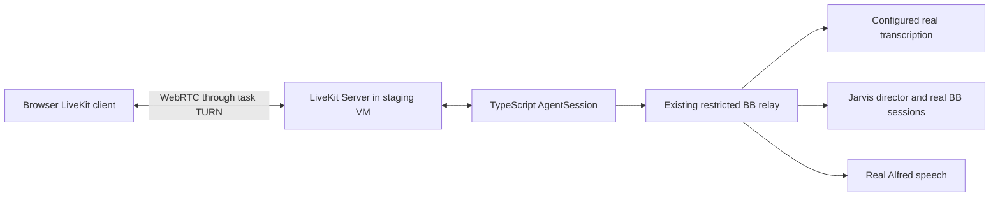

# LiveKit TypeScript conversation spike

Date: 2026-11-15. Status: staged conversation spike; initial Android user test reported successful. Extended device/car acceptance remains open. No stable promotion.

## Decision and implementation

Adopted the Node LiveKit Agents framework rather than reimplementing interruption,
turn and output queues. The new companion and browser code are TypeScript. The
existing BB React/TypeScript plugin exposes the page and authenticated controls.
No Python voice worker or LiveKit Cloud account is used by this candidate.

Pinned release set:

| Component | Version |
|---|---|
| LiveKit Server | 1.13.11 |
| LiveKit Agents Node / Silero plugin | 1.10.0 |
| rtc-node | 1.2.2 |
| livekit-client | 2.24.1 |
| livekit-server-sdk | 2.19.3 |

Server Linux amd64 release archive SHA-256:
`1e9ee90ca301e1842b2887fc77cb122759756a9c8aeb4334ee91de3325ec43fb`.
The package lock pins the complete Node dependency graph. ONNX optional CUDA
installation is disabled using its documented `ONNXRUNTIME_NODE_INSTALL=skip`;
the bundled CPU inference runtime remains installed. The first default installer
attempt exceeded the 2 GB VM's memory while extracting CUDA, before runtime
validation. CPU-only installation and the actual Silero runtime succeeded.

The real data path is:

The browser uses native microphone capture with browser AEC/noise suppression/gain
control requested and attaches LiveKit remote audio tracks to native audio
elements. It does not create a microphone AudioContext, feed a speaker reference
back into a custom canceller, suppress microphone input while speaking, or compare
recognized words to generated output to reject echo.

`BBSTT` implements the framework's batch STT provider contract. The official
stream adapter and Silero provide segmentation and pre-roll. `BBDirector`
implements its LLM contract and uses the existing authenticated director; provider
automatic retries are disabled because a directed answer can cause a BB write.
The documented TTS node converts Alfred's framed 24 kHz PCM to AudioFrames.
LiveKit owns output pacing, pauses, cancellation, resumption and transport.

VAD interruption is configured at 200 ms with zero minimum words, preserving
short controls. Framework false-interruption recovery is enabled at two seconds.
This uses the self-hosted VAD mode, not LiveKit Cloud adaptive interruption or
proprietary enhanced audio filters. Acoustic performance is not established by
merely enabling browser constraints or this configuration.

## Staging, permissions and diagnostics

Runtime remains in the existing disposable candidate VM. The rejected Pipecat and
SmartTurn workers are stopped and disabled; their source/evidence and a
pre-LiveKit source archive are retained outside the VM. Stable BB is unchanged.
The lab registry records exact VM identity, services, credentials, TURN ownership,
rollback and teardown requirements.

The page is `/api/v1/plugins/jarvis/http/livekit`. One Start button joins and
speaks a briefing of the actual recent threads. End releases capture, session,
room and relay ownership. Sessions abandoned without heartbeats expire after
90 seconds. Browser and agent have room-scoped, five-minute join tokens; the
browser receives neither LiveKit API credentials nor the restricted relay token.
Each room admits at most two participants and the user's publishing grant is
microphone-only. The worker subscribes to that exact user identity.

Both HTTP and WebSocket routes use BB's local-origin authentication. Signaling
runs through the existing BB review origin using its experimental WebSocket API;
media uses the already-approved task TURN route. The temporary separate 4847
signaling share/tunnel was removed after this integration worked. No new router
forward was added. Unauthenticated access to the public review URL returns 401.

The existing relay validates exact current question bindings and directed
answers. Watching or interruption grants no new authority. Server playout is not
marked as proof a question was physically heard. The question is explicitly
shown in the authenticated page alongside generated text.

Diagnostics include session IDs, state transitions, provider timings, synthesized
sample duration, committed interruption/completion, browser media byte counters,
packet loss/jitter, received audio energy, playback permission and microphone
state. Browser counters reach the worker journal every five seconds. A download
button preserves the client timeline. There is no microphone recording; ordinary
conversation text remains in the existing private BB journal. Generated text on
the page can include words interrupted before they were audible.

## Verification

The test browser receives actual candidate output over WebRTC/TURN. Its generated
microphone stream makes tests repeatable but bypasses physical acoustic capture;
these tests do not establish Android native AEC, Bluetooth routing or off-LAN
cellular acceptance.

- BB plugin typecheck/build and 51 existing tests passed. Three additional PCM
  framing tests passed locally and on the actual VM: arbitrary HTTP fragmentation
  preserves every sample; malformed/truncated streams fail instead of silently
  omitting audio; WAV metadata and samples match the provider input.
- Full round trip: injected “Wait, tell me what two plus two is” → actual STT →
  existing Jarvis director → actual Alfred → decoded browser audio saying “Two
  plus two is four.” Initial speech was interrupted and replacement output had
  nonzero decoded RMS (0.225 in the first successful run), without page errors.
  That run paused the framework after 288.5 ms and reached a quiet decoded sample
  another 142.7 ms later: approximately 431 ms total. This exceeds the earlier
  250 ms aspiration; it is not an acoustic latency measurement.
- The same round trip subsequently passed through the BB plugin WebSocket route,
  without the temporary separate signaling share.
- Uninterrupted real briefing: 1,227 characters, 55,936 ms synthesized audio,
  55,935.7 ms framework playout. The microphone remained enabled. No false user
  speech detections, interruptions, page errors, UI errors or received packet loss
  were observed. This is consistent with full-duration delivery and does not by
  itself prove the waveform was audible through a physical car speaker.
- Short control: the 606 ms “Wait” fixture was recognized exactly and interrupted
  the briefing. Framework pause occurred after 315.9 ms, followed by 264.2 ms to
  the first quiet decoded sample (approximately 580 ms total). The existing BB
  director interpreted it as quiet mode and spoke its acknowledgement. No page
  or UI error was observed. This confirms short-input preservation, not a 250 ms
  interruption target.
- At a 393×852 phone viewport the page has no horizontal overflow; the rendered
  screenshot was inspected. Start, End and diagnostics remain clear controls.
- End and room/session cleanup succeeded; a duplicate close after participant
  disconnect is now idempotent.

An initial integration test transcribed input but failed to trigger automatic
replies because an LLM node alone was not registered as an LLM provider. Replacing
it with the actual SDK provider contract fixed that failure. A staging build
failure also exposed a browser bundle filename collision; browser bundles now
have a distinct filename so TypeScript output cannot replace them with unbundled
imports. Both failures are retained as failed evidence, not counted as passes.

Speech uses a connection deadline and per-read inactivity timeout, not an overall
one-minute consumption timer that would cut off a long paced response.

Private detailed evidence lives outside the VM under the task's `jarvis-staging`
artifact directory: `livekit-roundtrip.json`, `livekit-endurance.json`, screenshots,
failed-run records and browser harnesses. A sanitized summary is committed here.

## Initial Android user test

Chris reported “That seemed to work pretty well” and supplied browser diagnostics
for 2026-11-15 16:43:38–16:45:15 UTC. The Android Chrome client timeline correlates
with a single staging worker session and its successful cleanup. This is the
first positive physical-device report for the LiveKit candidate. The reduced
user-agent string does not identify the actual Android version, and browser
settings do not identify the Bluetooth output route.

- About 96 seconds, an initial briefing and three transcribed user turns.
- All 18 media samples report microphone enabled and playback allowed. Received
  audio energy rises during the spoken responses. No reported packet loss,
  reconnect, client error, or framework false-interruption recovery event.
  Sampled jitter is 3–14 ms. Absence of a false-interruption event alone does not
  establish that every speech detection was intentional; the diagnostics omit text.
- One interruption of the opening briefing. The server transitions from detected
  user speech to agent listening in 160 ms (164 ms between client receipt events).
  This excludes physical voice onset, device buffering and acoustic output tail;
  it must not be compared directly with the earlier injected-onset timing.
- Two subsequent complete replies last 7.360 and 11.968 seconds by synthesis
  count; the agent speaking intervals match those durations. The final reply
  was still playing when the session ended, so its full delivery is not verified.
- From detected user end-of-speech to agent speaking: approximately 6.2, 7.9 and
  9.9 seconds. Batch transcription accounts for 0.85–0.99 seconds; most remaining
  time is between transcription and the director response. This makes response
  latency the clearest next improvement, with media delivery functioning in this
  short test.
- Disconnect is followed by server cleanup within about half a second. The
  download was made after End, so its top-level session ID is absent; matching
  phase timestamps/media counters supplied correlation. Retaining the last session
  ID after End is a diagnostics follow-up.

The original attachment remains in private thread storage; no device group ID or
conversation text was added to the repository. Positive spike feedback does not
constitute approval to promote the plugin to stable.

## Remaining acceptance and scope

1. Repeat the successful initial Android test across longer conversations and
   confirmed car Bluetooth routes: echo during silence, repeated short/quiet
   controls and genuine barge-in.
2. Framework false-interruption resume is configured and verified in upstream
   source; the physical route's false-interruption behavior is not yet accepted.
3. Thirty-turn conversation, route changes, backgrounding/lock screen and extended
   cellular loss are not validated. Join/TURN credential renewal for long sessions
   still needs production design.
4. Batch STT and the existing nonstreaming director remain response-latency costs.
   The director's durable history contains generated text, not exactly heard text.
   LiveKit's internal truncation cannot automatically repair this external history.
5. Continuous watched updates are not polled by this isolated conversation spike.
   The director supports its existing commands, but this does not complete the
   production hands-free chief-of-staff workflow.
6. Candidate-only supervision/setup is in the VM; a distributable BB companion
   installation/lifecycle package still needs production implementation.

## Sources and adoption basis

- [LiveKit Agents Node source](https://github.com/livekit/agents-js), audited at
  `1fa759cf67477f19466a68cb15e2e17de1908e04`: `AgentSession`, room audio output
  pause/resume, false-interruption recovery, provider and custom-node contracts.
- [Official Node starter](https://github.com/livekit-examples/agent-starter-node)
  supplies the framework lifecycle pattern; its hosted defaults were not silently
  adopted as self-hosted features.
- [Pipeline nodes](https://docs.livekit.io/agents/logic/nodes/) document the custom
  provider boundary used for Alfred.
- [Server installation](https://docs.livekit.io/transport/self-hosting/local/) and
  [pinned server release](https://github.com/livekit/livekit/releases/tag/v1.13.11).
- The broader OSS comparison and Python/Node decision are in
  [oss-conversation-stack-recommendation.md](oss-conversation-stack-recommendation.md).

The next integrated candidate is recorded in
[jarvis-livekit-integration.md](jarvis-livekit-integration.md). Its code now lives
in `plugins/jarvis/voice/`; historical spike measurements above are unchanged.
